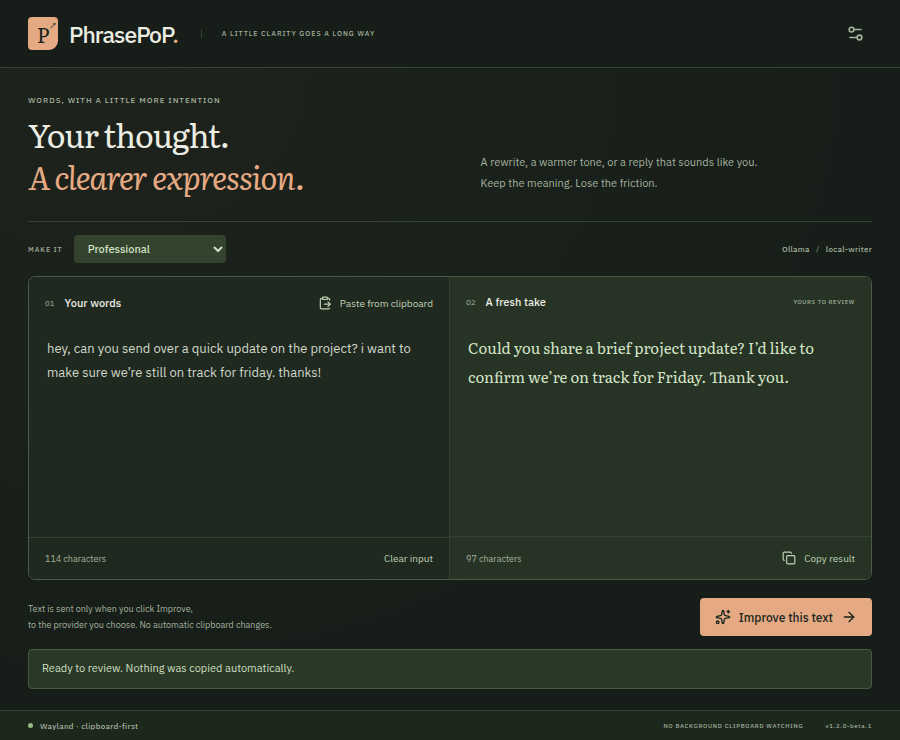
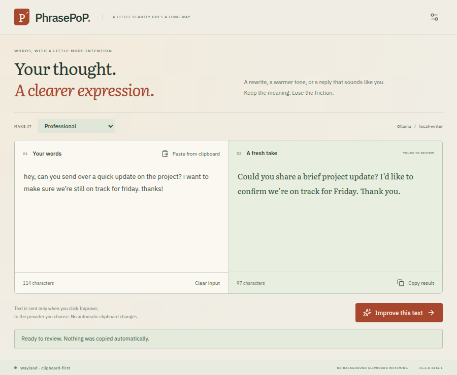

# PhrasePoP

### Your thought. A clearer expression.

A clipboard-first desktop writing assistant. Refine a sentence, change its tone,
or draft a reply in your own voice—with a local model or your chosen cloud provider.

[Download preview](https://github.com/vinzify/PhrasePoP/releases/tag/v1.2.0-beta.1) · [Contributing](CONTRIBUTING.md) · [Validation](docs/VALIDATION.md) · [Report an issue](https://github.com/vinzify/PhrasePoP/issues)



*Actual interface, captured with fictional text and mocked network responses.*

> **1.2 preview:** Linux, Windows, and macOS packages are being validated for
> [v1.2.0-beta.1](https://github.com/vinzify/PhrasePoP/releases/tag/v1.2.0-beta.1).
> Existing 1.1.x users must install this preview manually following the signing-key
> rotation. The old stable update channel is unchanged.

## Get PhrasePoP

Choose a package from the [preview release](https://github.com/vinzify/PhrasePoP/releases/tag/v1.2.0-beta.1):

| Platform | Package | Notes |
| --- | --- | --- |
| Linux x86_64 | `.deb`, `.rpm`, or `.AppImage` | Built on Ubuntu 22.04; clipboard-first on Wayland |
| Windows x64 | Setup `.exe` or `.msi` | Choose one installer |
| macOS Apple Silicon | `aarch64` `.dmg` | Apple M-series Macs |
| macOS Intel | `x64` / `x86_64` `.dmg` | Intel Macs |

Verify SHA256SUMS from the release. Updater signatures are separate from Windows
code signing and Apple notarization; OS trust warnings may appear. Do not install
an untrusted or unexpected download.

## A deliberate writing workflow

1. Copy text from any app, then open PhrasePoP—or paste/type directly into it.
2. Choose a style: professional, friendly, concise, persuasive, academic, or a
   reply using your saved context. Creative styles remain available too.
3. Click **Improve this text** and watch the result stream in.
4. Review it, then click **Copy result** when you are ready.

Your source stays intact. Results are **never copied automatically**. Your writing is not
sent to an AI service until you request a rewrite; clipboard import happens only
on your explicit action or a clipboard launch request.

## Made for your desktop

- **Dark by default.** Choose **Light** in Settings → Appearance and save. Your
  choice is stored locally and restored on the next launch.
- **Side-by-side editing.** Keep the source and result visible; select and copy
  text manually if clipboard integration is unavailable.
- **Stop when needed.** Cancel an in-flight request. Partial output remains
  visible, and a broken stream is not reported as a completed result.
- **No disappearing window.** Standard native window controls, resizing, and no
  forced always-on-top or hide-on-blur behaviour.
- **Optional desktop helpers.** Tray, autostart, a supported native shortcut, or
  your desktop's own launcher shortcut. Tray failure falls back to a normal window.
- **No clipboard watcher.** No polling, background collection, or automatic text
  replacement in other applications.

<details>
<summary>Prefer a lighter writing surface?</summary>



</details>

## Linux, Windows, and macOS

| Desktop | Clipboard workflow | Shortcut behaviour |
| --- | --- | --- |
| Linux / Wayland | Explicit clipboard import where supported; direct paste/type is the fallback | Assign your desktop's shortcut to `phrasepop --clipboard` |
| Linux / X11 | Clipboard-first | Configurable native shortcut where available |
| Windows | Clipboard-first | Configurable native shortcut where available |
| macOS | Clipboard-first | Configurable native shortcut where available |

**Copy text first.** Unlike older versions, this preview does not simulate Ctrl+C
or promise automatic selection capture from every application. Wayland native
global shortcuts and cross-app input capture are not universally interchangeable
with X11 APIs.

Wayland clipboard import uses arboard's data-control support, which depends on
compositor support. If it is unavailable, paste directly into **Your words**.
On Linux, keep the app open until you have pasted a copied result if your desktop
does not have a clipboard manager.

KDE Wayland native startup/settings were checked locally. Windows, macOS, X11,
and other compositor combinations still need native desktop validation. See
[the exact checks and remaining gaps](docs/VALIDATION.md).

## Bring your own model

Open Settings, choose a provider, and enter your model ID or use **Find models**.

- **Ollama:** defaults to `http://localhost:11434`; uses its HTTP API and NDJSON streaming.
- **LM Studio:** defaults to `http://localhost:1234/v1`; uses its OpenAI-compatible streaming API.
- **OpenAI:** enter a Chat Completions-compatible model ID and your API key.
- **Compatible:** enter another HTTP(S) OpenAI-compatible base URL and model ID.

Requests use Tauri's Rust HTTP backend, not browser CORS workarounds. The stream
reader buffers incomplete events and UTF-8 sequences across network chunks.
[Chat Completions streaming reference](https://developers.openai.com/api/reference/resources/chat/subresources/completions/streaming-events).

Your configured endpoint receives the input only when you click Improve.
Personal context is included only in **A reply in my voice** mode. A “local”
provider pointed at a remote endpoint is no longer local—check the URL before
sending sensitive text. Provider usage may incur costs.

API keys are held **only in memory for the current session**. Saving settings
removes any legacy plaintext key from local preferences. OS-keychain persistence
is not implemented yet. Other preferences, appearance, and reply context are
stored locally; input/result text is not saved as history.

## Run the preview from source

Install stable Rust 1.90 or newer, Node.js 22, and your platform's
[Tauri prerequisites](https://v2.tauri.app/start/prerequisites/).

```sh
git clone https://github.com/vinzify/PhrasePoP.git
cd PhrasePoP
npm ci
npm run tauri dev

# Build an unsigned local preview without updater-signing artifacts:
npm run tauri build -- --no-bundle --config '{"bundle":{"createUpdaterArtifacts":false}}'

# Run the Linux binary:
./src-tauri/target/release/phrasepop
./src-tauri/target/release/phrasepop --clipboard
```

Use `--bundles deb` instead of `--no-bundle` to build a local Debian package.
The CLI also accepts `--minimized`, `--help`, and `--version`.
A clipboard launch request does not replace an existing draft.

## Development checks

```sh
npm test
npm run lint
npm run format:check
npm run build
npx playwright install chromium
npm run test:e2e
cargo fmt --manifest-path src-tauri/Cargo.toml --check
cargo test --locked --manifest-path src-tauri/Cargo.toml
cargo clippy --locked --manifest-path src-tauri/Cargo.toml --all-targets -- -D warnings
```

Tests cover settings migration, theme persistence, provider/model selection,
stream framing, Unicode, cancellation, errors, explicit copying, and preserving
newer drafts. Browser tests mock Tauri IPC; they are not a substitute for native
desktop/provider checks. CI is configured for Linux, Windows, and macOS.

Preview limits: 50,000 input UTF-16 characters, 64,000 result characters, 2 MB of
stream data, and a two-minute request timeout. Clipboard imports larger than
200 KB are rejected. These limits protect the interface from oversized responses.

## License

[MIT](LICENSE). Bundled fonts retain their [OFL licenses](public/licenses/).
